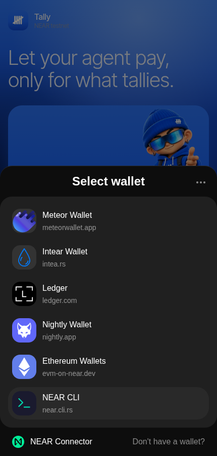

# Proofs

Live evidence for each NEAR integration, on testnet unless noted. Every link opens the transaction or
account on NearBlocks. Reproduce with the command in each section.

## 1. Gasless agent payments (NEP-366 meta transactions)

The agent signs `pay` as a delegate action with its function-call key; the app's relayer
(`/api/relay` on the Cloudflare Worker, account `tallynear-sponsor.testnet`) wraps it and pays the gas.
The contract holds every relayed `pay` to the agent's rules (no co-sign, strikes count, refused once
the agent is revoked) and refuses to relay owner actions.

| What | Evidence |
| --- | --- |
| CLI agent buys a croissant through the live relayer, receipt #23 | [8mN5iNz8…](https://testnet.nearblocks.io/txns/8mN5iNz8jfJq6jPV4ET1FSEc9PLRiqbVunJos8CnmBo7) |
| Owner's NEAR balance unchanged after a gasless pay | `web/test/e2e.live.test.ts` "gasless…" |
| Relayed pay never counts as the owner; revoked agent can't be relayed; `approve` can't be relayed | `relayed_pay_is_held_to_agent_rules`, `relayed_pay_refused_after_the_agent_is_revoked`, `owner_actions_cannot_be_relayed` |
| Relayer sponsors only `pay` on Tally (no other receiver, method, deposit or batch) | `packages/sdk/test/relay.test.ts` |

Reproduce: `TALLY_RELAY_URL=https://tally-near.adoranto737.workers.dev/api/relay pnpm --filter @tally-near/agent buy "a croissant"`

## 2. Sputnik DAO is the arbiter

Tally's `arbiter` is [`tally-arbiter.sputnikv2.testnet`](https://testnet.nearblocks.io/address/tally-arbiter.sputnikv2.testnet),
a Sputnik DAO whose council votes on disputes. No single key can slash a merchant's bond or blocklist it.

| Step | Transaction |
| --- | --- |
| DAO created (council: `tallynear-arbiter`, `tallynear-bob`) | [GeBmDh7j…](https://testnet.nearblocks.io/txns/GeBmDh7jcdyQgxto7skKu4iJ66DwxMf8QcvVqDVUDoTT) |
| Tally's arbiter set to the DAO | [7BXxQs6M…](https://testnet.nearblocks.io/txns/7BXxQs6MSwu3aiLmX3tjFyX66CbY7c5SBgaY645SPmst) |
| Alice disputes receipt #23 with an evidence hash | [59Tg9DH4…](https://testnet.nearblocks.io/txns/59Tg9DH4Pzig6o1AxwoHHgXQHKfLsSFGedKbtL2WvwTc) |
| Proposal #0: `resolve_dispute(23, upheld, 0.05 NEAR)` | [HYFnRUZp…](https://testnet.nearblocks.io/txns/HYFnRUZpPFwognnjy8ps6sLE6BgxHAk3fZ8xdBDqZEkW) |
| Vote 1 | [EzfWAAe3…](https://testnet.nearblocks.io/txns/EzfWAAe3MosqMFZMQa13quJdNGkmv3ykHQsoLLrE7j28) |
| Vote 2: approved, the DAO executes, 0.05 NEAR of the bond pays alice | [HCvd6fX6…](https://testnet.nearblocks.io/txns/HCvd6fX6dofYaEEQAkE1NptqUJRQheYnRziWMsGYJckZ) |

Check: `near contract call-function as-read-only tallynear.testnet get_dispute json-args '{"receipt_id":23}' network-config testnet now` → `"status": "upheld"`.
Reproduce: `pnpm --filter @tally-near/demo dao`.

## 3. NEAR AI Cloud TEE, verified (Intel TDX)

Before each purchase the agent fetches the NEAR AI Cloud gateway's Intel TDX quote bound to a fresh
32-byte nonce and verifies it the same way as [nearai-cloud-verifier](https://github.com/nearai/nearai-cloud-verifier):
Intel DCAP collateral check, then `report_data[0..32]` = gateway signing key and `report_data[32..64]` = our nonce,
read from the verified quote. Verified purchases carry `nearai-tdx:<status>:<quote>:<nonce>` in the on-chain receipt.

```text
$ pnpm --filter @tally-near/agent verify-tee
nonce            0eb8857ff72f3f16393a02b945c10b36011b170a4e83d1cb06d3d5362d6d1364
signing address  40599fb284f43953bb356b09080fd803c960fc10285ad90eca462ca711ad4acb
quote sha256     6375bb4aeeb793bd4d6c99fe05284f57e6b433a4689c1fdf861c4fac5f6a7d1e
Intel DCAP       UpToDate
binds address    true
binds our nonce  true
VERIFIED         true   receipt label: nearai-tdx:UpToDate:6375bb4aeeb793bd:0eb8857ff72f3f16
```

On-chain: receipt #24 ([AErn655d…](https://testnet.nearblocks.io/txns/AErn655dXAbarCWjziM42EmAAEdrvT6Fovdt7PHE9XKu), paid gaslessly) carries
`"attestation": "nearai-tdx:UpToDate:a83e6dbd72fea983:5064da35e9053215"`.

Also: MCP tool `tally_verify_tee`; tests `a verified quote must bind the signing address and our nonce`.
Scope: the app on Cloudflare records the nonce-bound quote digest (`nearai-gw:`); the full DCAP check runs in the agent
(Node), because the verifier's WebAssembly build loads from disk.

## 4. Verifiable contract: reproducible build + NEP-330 source metadata

The deployed contract is built in the pinned Docker image `sourcescan/cargo-near:0.22.0-rust-1.97.1` from a
committed revision of this repo, and embeds NEP-330 metadata naming that revision. Anyone can rebuild it
and compare hashes.

| Check | Value |
| --- | --- |
| Reproducible build of commit [`d1dc9a8`](https://github.com/ZINKUNO/Tally-Near/tree/d1dc9a857d0e4747208dd328d2c27c6ac0127563) | SHA-256 bs58 `DW5Qt5jUd1jXenDMt7gM1LHz8vh7Mru3GRNGnhmRbAde` |
| On-chain `code_hash` of `tallynear.testnet` | `DW5Qt5jUd1jXenDMt7gM1LHz8vh7Mru3GRNGnhmRbAde` (same) |
| Deploy transaction | [9Drgr2Xf…](https://testnet.nearblocks.io/txns/9Drgr2XfjtxKebL4sA8XGjS5cH3utmX6eQsbRZKJwVKe) |
| `contract_source_metadata` (NEP-330 1.3.0) | `source_code_snapshot: git+https://github.com/ZINKUNO/Tally-Near?rev=d1dc9a8…` |
| Earlier deployment, same procedure | commit `3ef9d93` → `6HcRTRu6…`, tx [6qexWrYU…](https://testnet.nearblocks.io/txns/6qexWrYUjvRDgThaVSSdKgkamCH2BcraKu6uTwjQrr5g) |

Reproduce:
```bash
git checkout d1dc9a857d0e4747208dd328d2c27c6ac0127563
cd contracts/tally && cargo near build reproducible-wasm     # prints the SHA-256 bs58 above
curl -s https://test.rpc.fastnear.com -H 'content-type: application/json' \
  -d '{"jsonrpc":"2.0","id":1,"method":"query","params":{"request_type":"view_account","finality":"final","account_id":"tallynear.testnet"}}'
near contract call-function as-read-only tallynear.testnet contract_source_metadata json-args '{}' network-config testnet now
```

## 7. NEAR Intents: real cross-chain top-ups

The family top-up page (`/send/<account>`) gets a live 1Click **deposit address** (non-dry quote): whoever sends
that much USDC on Base, Arbitrum, Ethereum or Polygon gets NEAR USDC delivered to the allowance owner's account id
on NEAR mainnet (a passkey's implicit account is the same id on both networks). The page shows a QR code and polls
the swap status. Tally never holds the funds.

| Check | Evidence |
| --- | --- |
| Live deposit address from the deployed app | `curl -X POST https://tally-near.adoranto737.workers.dev/api/intents -d '{"from":"base","usd":1,"recipient":"<64-hex>","refundTo":"0x…"}'` → `{"depositAddress":"0xB684012b…","amountOut":"995759","timeEstimate":35}` |
| Testnet recipients refused (they'd lose funds) | `{"error":"recipient must be a NEAR mainnet account…"}`; `packages/sdk/test/intents.test.ts` |
| Swap status | `GET /api/intents?depositAddress=…` (1Click `/v0/status`) |

Intents run on mainnet only, so an end-to-end swap needs a real deposit (from $1). A completed swap's
status and NEAR transaction will be added here.

## 8. NEAR wallet sign-in (HOT near-connect)

Besides the passkey, the landing page offers **"Have a NEAR wallet? Connect it instead"**: Meteor, Intear, Ledger,
Nightly, Ethereum wallets (via NEAR), NEAR CLI. The wallet's account becomes the owner and signs every owner action
(open allowance, add the agent's pay-only key, approve a Second Look, freeze, revoke); the browser only keeps the
agent's pay-only key, which pays gaslessly through the relayer. Wallet accounts get $50 of test USD from the sponsor.

| Check | Evidence |
| --- | --- |
| Wallet picker on the live app | screenshot below; https://tally-near.adoranto737.workers.dev → "Have a NEAR wallet?" |
| Owner calls, `AddKey`/`DeleteKey` go to the wallet with the exact actions | `web/test/wallet.test.ts` |
| Named accounts get test USD only, no NEAR | `web/test/passkey.test.ts` |



## 6. NEAR Chain Signatures: portable receipts

`sign_receipt(receipt_id)` makes the Tally contract ask NEAR's MPC network (`v1.signer-prod.testnet`) to sign a
settled receipt with a secp256k1 key derived for `tallynear.testnet` + path `tally-receipts`. The payload is the
EIP-191 hash of a canonical receipt digest, so **any EVM chain can `ecrecover` it** to confirm Tally on NEAR settled
that purchase (a merchant's books on another chain, a loyalty contract, an auditor). Verification needs nothing
from Tally: recompute the digest, derive the key from the MPC root key, recover.

| Check | Evidence |
| --- | --- |
| Contract calls the MPC signer, stores the signature | [HWYZCtVp…](https://testnet.nearblocks.io/txns/HWYZCtVpZ2MXxMDCLcb5b3MWCVpGFKKbMUwAn23LMH1m) (receipt #24) |
| Tally's derived EVM address | `0x2d3c430a7e50da6f2102091828424aeba9148b8b` |
| Independent check (digest, EIP-191 payload, ecrecover) | all `true`, below |
| Offline test on the live signature | `packages/sdk/test/portable.test.ts` + `fixtures/portable-receipt.json` |
| Contract tests | `receipt_digest_binds_every_field_and_the_mpc_answer_is_stored`, `unsettled_receipts_are_not_signed` |

```text
$ pnpm --filter @tally-near/demo portable 24
receipt   #24: 4.5 tUSDC from tallynear-alice.testnet to tallynear-cafe.testnet
digest    af176d8211c86d889d941a1036d1716a791f166d2193a1aac7d047c93d257037  recomputed matches: true
payload   cf20db6d592b2f3b9ab0c6d444c1b0e3cf0cb887d977142658825ad62e773b25  EIP-191 hash matches: true
signer    MPC v1.signer-prod.testnet, path "tally-receipts"
tally     Tally's derived EVM address 0x2d3c430a7e50da6f2102091828424aeba9148b8b
ecrecover 0x2d3c430a7e50da6f2102091828424aeba9148b8b  matches: true
solidity  ecrecover(0xcf20db6d…3b25, 27, 0x404f2d2e…53e1, 0x77ae8745…2135) == 0x2d3c430a7e50da6f2102091828424aeba9148b8b
```

## 5. NEAR AI Agent Market: Tally Guard, a hireable agent

Tally Guard is registered on the NEAR AI Agent Market (`api.market.near.ai`) as a worker agent, category
finance, with a live per-call plan ($1, up to 10 accounts, 1 h SLA). When hired, `pnpm --filter @tally-near/agent
market work` picks up the assignment, finds the NEAR accounts in the job, runs Tally's Guard and counterparty check
on each and submits a Markdown report: **OK to pay / Ask a human first / Do not pay**, with reasons.

| Check | Evidence |
| --- | --- |
| Agent profile (live) | `curl https://api.market.near.ai/v1/agents/tally-guard` → `"name":"Tally Guard"`, agent `73f0dbfc-659c-44bb-a502-987f4d38b1e4` |
| Pricing plan (live) | `curl https://api.market.near.ai/v1/agents/73f0dbfc-659c-44bb-a502-987f4d38b1e4/pricing-plans` → `per_call`, `"price_amount":"1"`, `"listing_status":"live"` |
| The deliverable it produces | `pnpm --filter @tally-near/agent market report tallynear-shady.testnet` → "Do not pay: merchant is on the shared blocklist…" |
| Account extraction | `packages/agent/test/market.test.ts` |

The agent's API token is stored in `~/.tally/market.json`, never in the repo. A hire is paid by the buyer through
the market (USD or USDC); the worker loop delivers automatically.
